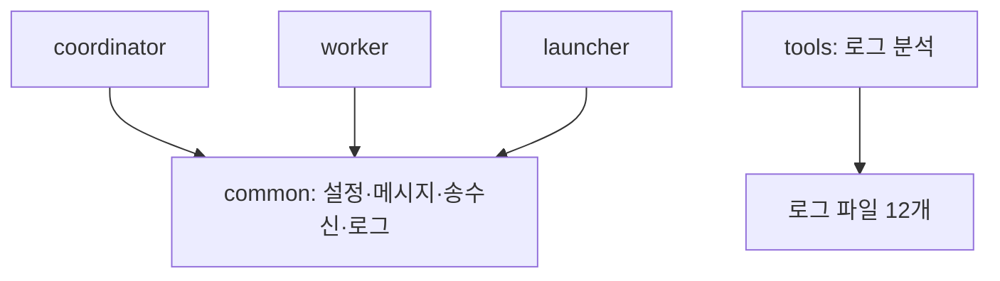

# HW3 - Fault-Tolerant 협업 Worker Ring

2026학년도 2학기 데이터통신 2조. **Python으로 확정**, HW2 코드는 재사용하지 않고 새로 구현한다.
현재 상태: Worker·Coordinator·로그 분석기 구현, 로컬 통합 검증 완료. 공통 모듈·Launcher는 별도 PR 반영 대기. 제출 기한: **2026-10-26(월) 23:59**.

사용자 확정: **안선효 : 황대겸 : 황왕석 = 4 : 3 : 3**을 목표로 배분하며 AWS Coordinator TCP 포트는 **4575**다. 공통 규약 4항목은 2026-10-14 안선효가 기존 안 유지로 확정했으며 황왕석이 구현한다.

이 README에 구현 계획·역할 분담·확정된 공통 규약을 정리한다.

## 1. 설계 방향

**프로세스별로 담당을 나누고, 담당 간 연결은 TCP 메시지로 제한한다.** Coordinator·Worker·Launcher는 서로의 Python 모듈을 import하지 않는다. 내부 상태·Lock·Queue도 각자 관리한다.

공통 패키지는 설정값·메시지·줄 단위 송수신·로그만 제공한다. Task 소유권·Worker 생사·crash 스케줄 같은 업무 상태는 공통으로 옮기지 않는다. 확정된 공통 규약 4항목을 사용하고, 필요하면 상대 프로그램을 TCP 대역으로 대체해 독립 개발한다.

실행 기준은 사용자 확정 규약인 **Python 3.12 이상, 표준 라이브러리만 사용**이다. Coordinator의 Dispatcher는 `threading.Thread` 6개를 직접 생성한다. 기본 Thread Pool 크기나 요청별 스레드 생성에 의존하지 않는다. 개인 테스트의 도구·방법·파일 구성은 각 담당이 자유롭게 정한다. 아래 테스트 폴더·대역은 선택 가능한 예시다.

| 프로그램 | 위치 | 담당하는 원본 데이터 |
| --- | --- | --- |
| Coordinator | 별도 물리적 원격 호스트 | Task의 state·owner·epoch·result·commit_count, Worker의 HB 기반 생존 상태 |
| Worker 10개 | 동일 로컬 PC의 독립 프로세스 | 자기 실행 상태·로컬 Task Queue·CKPT Store·crash_gen |
| Chaos Launcher | Worker와 같은 로컬 PC | 프로세스 핸들·제어 연결·무작위 장애 스케줄·CRASHED/REJOINING 수 |

## 2. 3인 역할 배분

기존 담당과 구조를 유지하고 로그 분석 도구만 황왕석에서 안선효로 이동한다. 4:3:3은 복잡도·통합 책임을 고려한 목표 비중이며 실측 시간 비율은 아니다.

| 담당 | 목표 비중 | 주 담당 범위 | 소유 경로 |
| --- | --- | --- | --- |
| **안선효(본인)** | **4** | Coordinator, 로그 분석·지표, AWS 배포, 최종 통합·문서·제출 취합 | `hw3/coordinator/`, `hw3/tools/` |
| **황대겸** | **3** | Worker 전체, 소수 계산, CKPT·crash·재합류 | `hw3/worker/` |
| **황왕석** | **3** | 확정된 규약의 공통 모듈 구현, Launcher | `hw3/common/`, `hw3/launcher/` |

공통 규약 결정은 조원 구현 업무에서 분리한다. 황왕석이 확정된 규약의 최소 공통 모듈을 구현하고 Launcher를 진행한다. 개인 테스트의 방법·대역·파일 구성은 각자 정한다.

### 안선효: Coordinator

- 아래 확정된 공통 규약 4항목을 조원에게 공지한다.
- Listener 1개, Dispatcher 6개, Failure Detector 1개, Main으로 구성한다. POOL은 Listener에서 5초마다 기록하고 추가 Monitor는 두지 않는다.
- HELLO·RING_OK 등록 완료를 Main의 CV로 기다려 RING·START를 전송한다. START 시각으로 lastHB를 초기화하고 FD를 시작한다.
- Listener는 Socket별 줄 버퍼를 관리하고 HB를 직접 반영한다. 나머지 요청은 Request Queue에 넣는다.
- Worker Table Lock 안에서 DEAD 확인·PENDING 꺼내기·Task 배정을 함께 처리한다.
- Task별 Lock 안에서 RESULT의 DONE·epoch·owner 검사와 Commit을 함께 수행한다.
- FD는 새 DEAD를 먼저 모두 표시한 뒤, 각 DEAD Worker 소유의 **모든 ASSIGNED Task**를 다음 ALIVE로 인계한다.
- Main이 마지막 Commit 통지를 받아 VERIFY·BYE·스레드 종료·join을 수행한다.
- 저장된 로그 12개를 읽는 `tools/verify_logs.py`를 구현해 정합성·장애 회차·복구 지표를 분석한다. 다른 프로그램의 내부 객체는 참조하지 않는다.
- AWS Coordinator를 TCP 4575로 실행하고 전체 연결·정식 실행·문서·제출을 취합한다.
- 담당 검증: 기동 차단, 중복 Commit·stale 결과, REQ/FD 경쟁, 동시 DEAD의 대상 선정, 재인계·종료. 대역 검증은 상태 전이와 정합성에 한정하며 최종 소수 합계는 실제 Worker와 확인한다.
- 반환물: 담당 소스·테스트, 스레드/Lock 구조 설명, 실행 명령, 검증 결과·남은 문제, 원격 배포 정보.

### 황대겸: Worker

- 프로세스 하나에 Control Recv·Compute·Heartbeat·Peer Server를 둔다. Compute는 하나로 Task를 차례로 계산한다.
- 구간 체로 소수를 계산한다. 진행 중 Task를 먼저 끝내고 인계 Task는 FIFO로 처리한다.
- CKPT는 고정 Buddy로만 보내며 Store는 Task별 최신 `(epoch, step)` 하나를 유지한다.
- CRASH에서 Queue·진행 Task·Store·requested·no_task를 지우고 TCP를 유지한 채 침묵한다.
- RESTART→REJOIN→WELCOME 후 HB·계산을 재개하고 새 Task를 요청한다. Worker가 epoch를 직접 증가시키지 않는다.
- 전송과 crash 전환, 수신 핸들러와 상태 초기화의 경쟁을 Worker 내부에서 해결한다. 상세 경계는 7절을 따른다.
- 담당 검증: 소수 누적값, CKPT 재개/소실, 반복 crash, 전송 직전 crash, READY 지연, NO_TASK 이후 TAKEOVER, CRASHED 중 BYE.
- 반환물: 담당 소스·테스트, 초기화 목록·송신 보장 설명, 재개 step 로그, 검증 결과·남은 문제.

### 황왕석: 공통 모듈 구현·Launcher

- 안선효가 확정한 메시지·API·CLI·로그 규약을 4절의 작은 공통 모듈로 구현한다. 공통 규약 설계·합의 업무는 맡지 않는다. 공통 모듈은 스레드를 생성하지 않는다.
- Launcher가 `subprocess.Popen`으로 Worker 10개를 직접 실행한다. Worker 클래스를 import하거나 같은 프로세스의 스레드로 실행하지 않는다.
- READY 10개 후 t0를 잡고 무작위 장애를 주입한다. CRASHED+REJOINING이 2개면 REJOINED까지 기다린 뒤 간격을 새로 추첨한다.
- 제어 연결 EOF를 EXITED로 처리하고 예정 RESTART를 취소한다. 모든 Worker 종료 후 Launcher를 종료한다.
- 확정된 로그 형식·필드를 구현하고 실제 추가 이벤트의 설명을 안선효에게 전달한다. 로그 분석 도구·지표 산출은 안선효가 담당한다.
- 담당 검증: 공통 송수신·로그 구현, 난수 호출 순서, 동시 장애 상한, 80초 이후 주입 중단, EOF·종료.
- 반환물: 담당 소스·테스트, 실행 방법·추가 이벤트 설명, 검증 결과·남은 문제.

## 3. 제안 패키지·파일 구성

아래는 담당별 패키지 구조다. Coordinator·Worker·tools는 구현했고, 공통·Launcher는 별도 담당 PR에 있다. 각 패키지에는 `__init__.py`를 둔다.

```text
HW3/
├─ README.md
├─ hw3/
│  ├─ __init__.py
│  ├─ common/                    # 황왕석: 업무 상태 없이 공통 규약만
│  │  ├─ settings.py             # 고정 수치·실행 설정의 불변 데이터
│  │  ├─ protocol.py             # Message, encode/parse, 필드 검증
│  │  ├─ transport.py            # LineBuffer, 송신 Lock·부분 쓰기 처리
│  │  └─ log.py                  # 노드별 파일·공통 로그 형식
│  ├─ coordinator/               # 안선효
│  │  ├─ __main__.py             # 실행 인자·구성·기동·Ring·VERIFY·BYE·join
│  │  ├─ tables.py               # Task/Worker Table·PENDING·Lock·지표
│  │  ├─ listener.py             # select 감시·직접 HB 처리·Queue 적재
│  │  ├─ dispatcher.py           # 고정 6개, 배정·결과·재합류 처리
│  │  └─ detector.py             # 1초 FD·다음 ALIVE·전체 소유 Task 인계
│  ├─ worker/                    # 황대겸
│  │  ├─ __main__.py             # 실행 인자·구성·스레드·READY·정상 종료
│  │  ├─ state.py                # 상태·crash_gen·Queue·Store·CV
│  │  ├─ network.py              # Control Recv·Peer Server·송신 경계
│  │  ├─ heartbeat.py            # RUNNING에서만 1초 HB
│  │  ├─ compute.py              # step 계산·CKPT·RESULT·다음 REQ
│  │  └─ primes.py               # 작은 소수·구간 체·step 범위
│  ├─ launcher/                  # 황왕석
│  │  ├─ __main__.py             # 실행 인자·제어 연결·READY/REJOINED/EOF·종료
│  │  ├─ processes.py            # Worker 명령 작성·Popen·핸들 관리
│  │  └─ chaos.py                # RNG·상태 표·crash/restart 시각 결정
│  └─ tools/                     # 안선효
│     └─ verify_logs.py          # 동일 실행 로그·장애별 지표 검사
└─ tests/
   ├─ coordinator/               # 안선효: 테스트와 자기 TCP 대역
   ├─ worker/                    # 황대겸: 테스트와 자기 TCP 대역
   ├─ common/                    # 황왕석
   ├─ launcher/                  # 황왕석: 테스트와 자기 TCP 대역
   └─ integration/               # 안선효 취합, 각 담당이 자기 오류 수정
```

파일 수를 줄이려면 같은 담당의 파일만 합칠 수 있다. 각 실행 패키지의 `__main__.py`가 인자 처리·초기화·실행·종료를 담당한다. 필요하면 launcher의 `processes.py`도 `__main__.py`에 합칠 수 있지만 Worker 상태나 Coordinator 테이블을 공통 패키지로 합치지 않는다.

## 4. 최소 공통 계약과 의존성



Coordinator↔Worker, Worker→Buddy, Launcher↔Worker는 TCP로만 연결한다. Launcher↔Coordinator 연결은 없다. `common`은 다른 HW3 패키지를 import하지 않고 소유권·생존 상태·전역 Queue를 갖지 않는다.

### 사용자 확정 공통 규약: 4개

아래 4항목과 이에 대응하는 API·메시지·CLI·로그 상세는 **2026-10-14 사용자 선택으로 확정**됐다. `common/settings.py`, `common/protocol.py`, `common/transport.py`, `common/log.py`와 각 프로그램의 `__main__.py`가 따르는 계약이다.

| 확정 항목 | 계약 |
| --- | --- |
| 메시지 문법 | UTF-8·LF 한 줄, PDF 예제의 메시지명·필드 순서 유지 |
| 공통 API | 아래 settings·protocol·transport·log API 유지 |
| 실행 환경·인자 | Python 3.12 이상·표준 라이브러리, `python -m`, 기존 인자명·ms 단위 유지. **Coordinator TCP 4575는 확정** |
| 로그 계약 | 기존 KST·텍스트+JSON·파일명 12개·이벤트 필드·동일 run_id 유지 |

PDF의 필수 동작·수치와 담당 내부의 자료구조·스레드 배치·테스트 방식은 사전 공통 결정 항목에 추가하지 않는다. 공통 API 내부 구현은 담당자가 결정한다.

| 모듈 | 고정할 계약 | 경계 |
| --- | --- | --- |
| settings | 과제 상수 + 읽기 전용 실행 설정 | Task 크기·Worker 수·타임아웃을 한 곳에서 정의. 살아 있는 상태를 넣지 않음 |
| protocol | `Message(kind: str, fields: tuple[str, ...])`, `encode(message) -> str`, `parse(line) -> Message` | encode는 LF 없는 문자열 반환. 문법·필드 범위 검사만 하며 생존·epoch 유효성 판단은 각 프로그램 담당. 잘못된 문법은 `ProtocolError` |
| transport | `LineBuffer.feed(bytes) -> list[str]`, `send_line(socket, line, send_lock)` | feed는 미완성 줄을 보관. send_line은 LF 하나를 붙여 전체 바이트를 직렬화해 송신하며 업무 Lock을 받지 않음 |
| log | `NodeLogger(node, path, run_id)`, `write(event, status, fields)`, `close()` | 자기 파일 하나만 관리. 다른 노드의 파일을 지우거나 통계 상태를 변경하지 않음 |

공통 구현 전에는 각 담당이 내부 상태·계산과 테스트 대역을 개발한다. 공통 최소 구현은 먼저 하나의 기준으로 통합하고, 세 담당이 같은 커밋에서 시작한다. 공통 파일을 각자 복사해 수정하거나 담당별로 다른 버전을 사용하지 않는다. 테스트 대역은 `tests/`에만 두고 제품 실행에 연결하지 않는다.

공통 규약 변경이 필요하면 이유·영향 경로·수정할 호출을 보고하고 안선효가 결정한다. 각 담당 소유 파일은 해당 담당이 수정하며 안선효가 최종 통합을 확인한다.

### 합칠 때의 문제와 예방 기준

| 통합 문제 | 예방 기준 |
| --- | --- |
| encode/parse의 인자·필드 해석이 서로 다름 | 공통 모듈을 한 번 구현·검증하고 같은 기준 커밋 사용. 메시지별 정상/오류 예제를 `tests/common/`에서 관리 |
| 각자의 fake 상대가 실제 상대와 다르게 동작 | 대역 테스트와 별도로 실제 Coordinator·Worker·Launcher를 초반부터 연결. 실제 상대와의 통과 기록이 있어야 기능 완료 |
| ACK·ASSIGN·TAKEOVER 도착 순서를 다르게 가정 | 허용 순서를 공통 계약에 기록. ACK 뒤에만 ASSIGN이 온다고 가정하지 않으며, 계산 중 TAKEOVER·늦은 ACK·재합류 메시지 사례도 검사 |
| CLI·경로·Python 환경이 맞지 않음 | 같은 `python -m` 진입점·인자·run_id·로그 위치 규약으로 실행. Launcher는 자기 인터프리터로 별도 Worker 프로세스를 실행 |
| 로그는 남지만 분석기가 다른 필드를 기대함 | 이벤트별 필드명·자료형을 공통 기준으로 고정하고, 실제 프로그램의 로그 12개를 분석기에 넣어 확인 |
| 공통 파일·README를 동시에 수정해 Git 충돌 | `common/`·루트 패키지 초기화는 황왕석, 공통 README 취합은 안선효. 각 소유 파일 변경은 담당자가 반영 |

공통 규약은 `CONTRACT_VERSION=1`로 시작하고 INIT 로그의 `contract_version`에 기록한다. 메시지·함수 서명·로그 필드·실행 인자 변경은 규약 변경으로 관리한다. 변경 시 영향을 받는 호출부와 테스트를 함께 준비하고, 세 담당이 같은 버전으로 전환한다. HELLO 등 과제 메시지 형식을 임의로 늘리지 않는다.

통합·실행 시나리오·로그 검사는 안선효, Worker 상태·계산은 황대겸, 공통 모듈·Launcher는 황왕석이 맡는다. 재현 명령·관련 로그·기대 동작을 남기고 소유 담당이 자기 코드에서 수정한다.

### settings의 고정 수치

| 항목 | 정식 값 |
| --- | --- |
| Worker / Dispatcher | 10개 프로세스 / 6개 고정 스레드 |
| AWS Coordinator TCP 포트(사용자 확정) | 4575; 실행 인자로 전달 |
| Task / step | Task 1,000개, Task당 수 100,000개; step 10개, step당 수 10,000개 |
| step 범위 | `lo=k*100000+(s-1)*10000+1`, `hi=lo+9999`, 양 끝 포함 |
| Buddy / Peer 포트 | `i mod 10 + 1` / `7000+i` |
| HB / FD / POOL | 각각 1초 / 1초 / 5초 |
| SUSPECT / DEAD | 마지막 HB 후 3초 이상 / 5초 이상 |
| 첫 CRASH / 이후 간격 | READY 10개 시각 t0 후 10–20초 / 직전 CRASH 후 5–15초 |
| RESTART / 주입 종료 | CRASH 후 10–15초 / t0 후 80초부터 새 CRASH 없음 |
| 재접속 / REJOIN 재시도 | 접속 거절 후 0.5초 / RETRY_LATER 후 2초, 아직 REJOINING일 때만 |
| 정식 step delay / 예상 합계 | 100ms / 5,761,455 |

소수 함수의 검증값: 작은 소수 1,229개·마지막 9,973, Task 0=9,592·152=6,075·160=5,989·271=5,802. step별 누적값도 공식 명세와 대조한다.

## 5. 프로세스 사이의 통신 규약

Socket별 UTF-8 수신 버퍼로 LF 단위 메시지를 자른다. 한 recv에 여러 줄 또는 일부 줄만 와도 처리한다. 문법은 과제 예제를 그대로 사용한다.

| 방향 | 메시지 |
| --- | --- |
| Worker→Coordinator | `HELLO i ip port`, `RING_OK i`, `HB i`, `REQ i`, `RESULT k e v`, `REJOIN i` |
| Coordinator→Worker | `RING j ip port`, `START`, `ASSIGN k e`, `NO_TASK`, `TAKEOVER k e from=d`, `ACK k`, `REJECT_STALE k reason`, `WELCOME`, `RETRY_LATER`, `BYE` |
| Worker→Buddy | 연결 첫 메시지 `PEER i`, 이후 `CKPT k e s partial` |
| Launcher→Worker | 연결 첫 메시지 `LAUNCHER`, 이후 `CRASH`, `RESTART` |
| Worker→Launcher | `READY i`, `REJOINED i` |

범위: Worker i·j·d=1–10, Task k=0–999, epoch e≥1, CKPT s=1–9. ASSIGN epoch=1, TAKEOVER마다 Coordinator가 +1. RESULT 거부 순서는 DEAD→DONE→EPOCH이며 owner 불일치도 EPOCH로 거부한다.

Coordinator는 HELLO로 등록한 **도착 Socket**으로 메시지를 보낸 Worker를 판별한다. Worker는 타 Worker 생사를 판단하지 않으며 CKPT 경로와 HB 장애 판정을 섞지 않는다.

Worker의 다음 REQ는 RESULT 송신 후 진행 Task·대기 Queue가 모두 없고 requested·no_task가 모두 False일 때 한 번만 보낸다. ASSIGN·NO_TASK에서 requested를 내린다. CKPT는 step 1–9 완료 뒤, RESULT는 step 10 완료 뒤 보낸다. 인계는 DEAD·SUSPECT를 건너뛴 다음 ALIVE이며, ALIVE가 전혀 없으면 첫 SUSPECT라는 명세의 예외 규칙을 적용한다.

### 실행 명령

명령은 `HW3` 폴더에서 실행한다. Coordinator와 분석기는 실제 공통 모듈·Worker·Launcher를 연결한 별도 폴더에서 로컬 실행을 검증했다. 원격 AWS 실행은 미검증이며 공통·Launcher 담당 PR을 먼저 통합해야 한다. IP·포트·seed는 인자로 전달한다. `run_id`는 양쪽에서 같은 값을 수동 지정해 동일 실행 로그를 묶는다.

```bash
# 원격 호스트
python -m hw3.coordinator --host 0.0.0.0 --port 4575 --run-id hw3-run01 --log-dir logs/hw3-run01

# 로컬 PC: Launcher가 Worker 10개를 실행
python -m hw3.launcher --coord <REMOTE_IP>:4575 --workers 10 --peer-ip 127.0.0.1 --peer-base 7000 --step-delay 100 --seed 42 --run-id hw3-run01 --log-dir logs/hw3-run01

# Launcher가 내부적으로 실행하는 Worker 명령 예
python -m hw3.worker --id 1 --coord <REMOTE_IP>:4575 --peer-ip 127.0.0.1 --peer-port 7001 --step-delay 100 --run-id hw3-run01 --log-dir logs/hw3-run01
```

Launcher는 자신의 `sys.executable`을 사용하고 명령 인자를 리스트로 전달한다. Worker 경로·클래스를 import하지 않으므로 테스트에서는 자기 fake Worker 명령으로 교체해 독립 검증할 수 있다.

## 6. 로그 계약과 검증 담당의 독립성

형식은 `[HH:MM:SS.mmm] NODE | EVENT | STATUS | message`, 시간대는 사용자 확정 규약에 따라 KST로 통일한다. 타임아웃·지연 계산에는 각 프로그램의 단조 시계를 사용하고, 로그 간 대조에는 동기화한 실제 시각을 사용한다.

`message`는 JSON 객체로 기록한다. 모든 행에 `run_id`와 `ts_unix_ms`를 넣고 이벤트별 필드를 추가한다. 이 방식으로 검증 도구가 문장이나 필드 순서에 의존하지 않도록 한다. 파일은 `Coordinator.txt`, `Worker1.txt`–`Worker10.txt`, `Launcher.txt`다.

| EVENT | 최소 필드 |
| --- | --- |
| INIT / START | node·설정값·contract_version / 시작 시각·ring_ready |
| ASSIGN | task, epoch, worker |
| CRASH / RESTART | worker, 해당 Worker의 장애 회차, down 목록 / worker |
| SUSPECT / DEAD | worker, last_hb_elapsed_ms, elapsed_ms; DEAD는 owned_tasks, to_worker, dead_now |
| TAKEOVER (Coordinator) | task, old_epoch, epoch, from_worker, to_worker |
| TAKEOVER (Worker) | task, epoch, from_worker, ckpt_epoch, resume_step |
| RESULT / COMMIT | task, epoch, worker, result; COMMIT은 commit_count |
| REJOIN / WELCOME | worker, rejoin_count |
| REJECT_STALE | task, epoch, worker, reason |
| POOL / VERIFY | queue·pending·assigned·done·alive / done·commits·double_commit·sum·pass |

RING·CONNECT·CKPT·HB·TERMINATE와 추가 이벤트도 `AllDefinedLogs.txt`에 정의한다. Launcher 장애 회차와 Coordinator 감지 회차는 **Worker 번호와 반복 순서**로 대조한다. Coordinator가 Launcher의 crash 스케줄을 알게 만들지 않는다.

Coordinator의 elapsed_ms와 last_hb_elapsed_ms는 START 시각을 0으로 한 같은 단조 시계 기준이다. 감지 지연은 두 값의 차이로 계산한다. Worker의 재개 로그가 없는 TAKEOVER는 CKPT 절약률 분자에 0을 더하고 인계 Task 수에는 포함한다.

검증 도구는 1,000 DONE·각 commit_count=1·합계 5,761,455·COMMIT 1,000개·CRASH/DEAD/승인 REJOIN 수 일치·동시 장애 최대 2개·재합류 후 새 Task를 검사한다. 복구 시간은 재인계까지 추적한 최종 Commit을 기준으로 하고, CKPT 절약률은 Worker의 resume_step에서 계산한다.

### 구현 시 안내: 영상에서 요구 동작을 확인하기 쉬운 로그

**구현 단계부터 영상 시연의 가독성을 고려해 로그를 설계한다.** 교수자가 화면에서 필수 기능과 상태 전이를 쉽게 찾고, 같은 Task의 장애·인계·재개·완료를 따라갈 수 있어야 한다. 기존 KST·텍스트+JSON 형식, 이벤트명·필드·파일명 12개는 유지한다.

| 확인할 동작 | 화면에서 찾기 쉬워야 할 정보 |
| --- | --- |
| 실행 구성·시작 | 원격 Coordinator 주소·TCP 4575, 로컬 Worker별 id·PID·Peer 포트, 실제 Dispatcher 수·Task별 Lock 수. HELLO 10개 → RING → RING_OK 10개 → START, READY 10개 |
| 정상 계산·진행 | ASSIGN의 Task·epoch·Worker, CKPT의 step·partial, RESULT·COMMIT. POOL은 pending·assigned·done을 동일한 순서로 표시 |
| 가상 crash·장애 감지 | Launcher의 victim·장애 회차·down 목록과 CRASHED+REJOINING 수, Worker의 CRASH 전환·기억 초기화. Coordinator의 SUSPECT → DEAD와 마지막 HB 기준 경과시간 |
| 인계·CKPT 재개 | 동일 Task의 from/to Worker·old/new epoch, Worker의 ckpt_epoch·resume_step·초기 partial. CKPT가 없으면 step 1·partial 0임을 명시 |
| 반복·연속 Buddy 장애 | 재인계된 Task도 Task 번호로 이어서 추적. 죽은 Worker의 원래 Task와 인계받은 Task가 모두 이동했는지 확인 가능하게 기록 |
| 재합류·종료 | RESTART → REJOIN → WELCOME → REJOINED와 새 ASSIGN. PENDING이 없으면 NO_TASK로 표시. 최종 VERIFY의 done=1000·commit_count 검증·double_commit=0·sum=5761455·PASS/FAIL, BYE·종료 |

- Task·epoch·Worker·step 등 식별 필드는 눈에 잘 들어오는 일정한 순서로 기록한다. 이벤트 한 건을 줄 단위로 완성해 출력하며 스레드 출력이 한 줄 안에서 섞이지 않게 한다.
- 시연 화면에는 기동·장애·인계·재합류·POOL·VERIFY를 중심으로 표시하고, 반복되는 HB·CKPT 상세는 원본 로그 파일에 보존한다. 표시 필터는 파일 내용을 바꾸지 않는다. 색상은 선택 사항이며 색상 없이도 의미를 읽을 수 있어야 한다.
- 여러 노드의 로그를 보여 줄 때 NODE·실제 시각·run_id·Task·epoch로 연결한다. 전역 메시지 순서를 임의로 맞추지 않으며 Launcher CRASH와 Coordinator DEAD의 시차도 그대로 보여 준다.
- 로그는 실제 상태 전이·계산·수신·송신 결과를 기록한다. send 성공만으로 상대 처리 완료를 표시하지 않는다. 가상 crash의 TCP 유지·송신 중단과 스레드/Lock 준수는 실제 동작 확인을 함께 남긴다.
- 시연용 출력 때문에 업무 Lock 안에서 I/O하거나 Coordinator에 허용되지 않은 로그 스레드를 추가하지 않는다. 필수 기록은 없애지 않고, 출력이 HB·FD·복구를 방해하지 않도록 구현한다.
- 정식 영상과 제출 로그는 동일 원격 실행에서 얻는다. 개발용 수동 이웃 장애 실행은 별도로 구분하고 정식 무작위 장애 실행의 증거로 섞지 않는다. REJECT_STALE 등 실제 발생한 추가 경로만 설명한다.

각 담당은 자기 이벤트의 가독성을 구현하면서 확인하고, 안선효는 실제 실행 로그로 위 동작을 찾아볼 수 있는지 최종 취합한다. 실제 수행한 검증 범위와 결과는 9절에 구분해 기록한다.

## 7. 핵심 동기화·장애 경계

- Coordinator Lock 순서: Worker Table→Task(오름차순). Task마다 독립 Lock을 만들고 상태 Lock 밖에서 send한다.
- Worker Lock 순서: Queue→state→Store. 수신 처리의 상태/세대 확인과 Queue·Store 변경 사이에 CRASH가 끼어들지 않도록 보호한다.
- Worker는 Task를 꺼낸 순간의 crash_gen을 기억한다. Compute·HB·REQ 등 정상 송신은 같은 세대이고 RUNNING일 때만 허용한다.
- **송신 직전 확인만으로는 충분하지 않다.** Worker의 송신 전용 직렬화 경계를 CRASH 전환과 공유한다. 송신 경계 안에서 state/세대를 확인하고 state Lock을 푼 뒤 전송한다. CRASH는 같은 경계에서 진행 중 송신이 끝난 뒤 CRASHED 전환·초기화를 수행한다. 네트워크 I/O 동안 Queue·state·Store Lock은 보유하지 않는다. 송신 무한 대기는 유한 타임아웃으로 제한한다. 이 방법은 설계안이며 경쟁 테스트로 확인해야 한다.
- 송신 경계는 Queue·state·Store Lock 밖에서 진입한다. CRASH 처리의 중첩 순서는 송신 경계→Queue→state→Store로 고정한다. 공통 send_line의 Socket 송신 Lock과 Worker의 상태 전환 경계는 별개로 두어 동일한 비재진입 Lock을 두 번 잡지 않는다.
- Buddy CKPT 송신 오류는 WARN 후 계산을 계속하고 Coordinator 연결 오류는 치명적 오류로 기록한다. CRASH 판정은 EOF로 대체하지 않는다.
- CRASHED에서는 받은 메시지를 읽고 버리되 RESTART·BYE는 처리한다. REJOINING에서는 CKPT를 저장하고 REJOIN을 보내지만 Compute·HB는 WELCOME까지 대기한다.
- NO_TASK 후에는 인계 Task를 처리해도 새 REQ를 보내지 않는다. crash에서 no_task를 초기화하므로 재합류 후 REQ 가능하다.
- READY는 START 수신과 Launcher 연결이 모두 갖춰진 순간 한 번 전송한다. BYE는 CRASHED 상태에서도 모든 CV 대기를 깨워 종료한다.

연속 Buddy 검증은 W4→W5뿐 아니라 **W10→W1**도 포함한다. W4 작업 A를 W5에 인계한 뒤 W5까지 죽으면 W5의 원래 작업 B와 인계 작업 A를 모두 다음 ALIVE에 다시 넘긴다. A는 epoch 1→2→3으로 진행하고, CKPT가 사라졌으면 처음부터 계산한다.

## 8. 개발 순서와 완료 기준

| 단계 | 각자 구현하면서 함께 연결할 범위 | 통합 통과 기준 |
| --- | --- | --- |
| 0. 공통 구현 | 황왕석은 확정된 4항목의 최소 구현. 안선효·황대겸은 내부 로직 개발 | 확정 규약 공지, 세 담당의 공통 구현·버전 동일 |
| 1. 실제 기동 연결 | 실제 Launcher가 실제 Worker 10개 실행, 실제 Coordinator에 등록·Ring 연결 | HELLO 10개→RING→RING_OK 10개→START, READY 10개, HB 수신. 계산 기능 완성까지 이 확인을 미루지 않음 |
| 2. 정상 흐름 연결 | 실제 REQ→ASSIGN→계산→CKPT→RESULT→ACK, 정상 종료 | 첫 Task의 왕복을 먼저 확인하고 장애 없는 1,000 DONE·합계·종료를 검증 |
| 3. 단일 장애 연결 | 개발용 수동 CRASH→FD→TAKEOVER→RESTART→REJOIN | 실제 CKPT 다음 step 재개, 새 epoch로 한 번 Commit, 재합류 후 새 Task |
| 4. 반복·이웃 장애 연결 | 실제 프로그램으로 재인계·메시지 경쟁, 이후 무작위 Launcher | 기존 인계 Task 누락 없음, 동시 장애 ≤2, stale 결과 거부, W10·W1 경계도 통과 |
| 5. 제출 실행 | 안선효 AWS 배포·로그 분석·취합, 황대겸 Worker 확인, 황왕석 Launcher 확인 | AWS TCP 4575 + delay 100에서 동일 실행 로그 12개, 정합성 PASS, 문서·영상·ZIP 검증 |

**통합은 모든 담당의 구현이 끝난 뒤 한 번 하는 작업이 아니다.** 기능을 추가할 때마다 직전까지 통과한 실제 연결 검사를 다시 확인한다. 독립 테스트는 담당 내부 로직 확인에 사용하고, 상대 프로그램과 연결되는 기능은 실제 상대와의 검사까지 통과해야 완료로 처리한다.

PR에는 독립 테스트 결과와 실제 연결 결과를 구분해 기록한다. 현재 단계의 실제 연결이 깨졌다면 해당 기능은 통합 미완료로 표시한다. 다음 단계로 넘어가기 전에 재현 로그로 원인을 좁히고 소유 담당이 수정한다. 여러 스레드·TCP 연결의 전역 메시지 순서를 하나로 고정하지 않고, Task별 owner·epoch·Commit 조건과 필요한 선후 관계를 검사한다.

기능 PR을 통합할 때는 최신 기준 브랜치에 맞춘 뒤 단계별 연결 결과를 확인한다. 공통 변경으로 호출부가 깨지면 관련 수정까지 묶어 검증하고 공통 코드만 먼저 반영하지 않는다. 최종 정식 실행에는 실제 세 프로그램만 사용한다. 실제 수행한 검증 범위와 결과는 9절에 구분해 기록한다.

## 9. Coordinator·로그 분석기 구현과 검증

- Coordinator는 Main 외 Listener 1개·Dispatcher 6개·FD 1개만 만든다. 요청·상태·종료 대기는 Queue/Condition을 사용한다. 로그 전용 스레드는 없다.
- RESULT의 Worker 상태는 Worker Table Lock에서 읽고, 해당 Task Lock에서 epoch·owner 확인과 Commit을 묶는다. REQ의 상태 확인·PENDING 추출·Task 배정은 Worker Table Lock 구간에서 원자적으로 처리한다.
- 같은 Worker의 Dispatcher 처리는 Socket 송신 RLock으로 순서를 보호한다. 재합류 승인의 WELCOME보다 새 ASSIGN이 먼저 전송되는 경쟁을 막는다. 송신 중 Worker/Task 상태 Lock은 잡지 않는다.
- FD는 START 전송 후 시작한다. 새 DEAD를 전부 표시한 뒤 번호순으로 모든 소유 Task를 재인계한다. 실제 TCP EOF는 가상 crash로 판정하지 않고 실행 오류로 종료한다.
- `DEAD_SCAN`으로 해당 장애의 Task 순회 완료를 기록한다. 분석기는 이 시점에 미완료 소유 Task가 남지 않았는지 검사한다. FD가 해당 Task를 잠그기 전에 이미 진행 중이던 RESULT가 Commit된 경우는 인계 대상에서 제외한다.
- `seq`와 `elapsed_ms`는 Coordinator가 상태를 판정한 순서·단조 시각이다. 파일 쓰기는 상태 Lock 밖이므로 행 순서가 달라도 분석기는 `seq`로 복원한다. 노드 사이에는 실제 시각·run_id·Task·epoch를 사용한다.
- 마지막 Commit 후 Main이 VERIFY·장애별 SUMMARY·BYE·STOP 6개·스레드 join을 처리한다. 콘솔에는 주요 이벤트를 표시하고, `--quiet`여도 파일 로그는 모두 남긴다.

분석기는 다른 프로그램 객체를 import하지 않고 동일 실행의 로그 12개만 읽는다. Task별 배정·재인계·Commit의 owner/epoch, Worker RESULT 대응, 전체 합계, 장애 상한·회차·재합류 및 정상 종료를 검사한다. 재인계된 Task의 복구 시간은 최종 Commit까지 추적하며 재개 로그가 없는 인계의 CKPT 절약 분자는 0이다. PASS는 로그 정합성 판정이며 물리적 원격 배포 증명은 별도다.

```bash
python -m hw3.tools.verify_logs --log-dir logs/hw3-run01 --run-id hw3-run01 --output logs/hw3-run01/analysis.json
python -m unittest discover -s tests/coordinator -v
python -m unittest discover -s tests/tools -v
```

`--allow-no-crashes`는 무장애 개발 로그에만 사용한다. 잘못된 파일·혼합 run_id·중복 Commit·오래된 owner/epoch·불완전 종료는 실패로 반환하며 CLI 종료 코드는 PASS=0, FAIL=1이다. 동일 run_id/로그 폴더를 재사용하지 않는다.

현재 확인 결과는 Coordinator 테스트 11개, 분석기 테스트 16개 통과다. 별도 폴더에 실제 공통·Launcher 담당 소스를 연결한 **로컬** 100ms·seed 42 실행에서 Worker 10개, 장애 6회, 1,000 DONE·Commit 1,000개·이중 Commit 0·합계 5,761,455와 전체 정상 종료를 확인했다. 최종 실행시간 약 118.110초이며 동일 실행 로그 12개 분석은 PASS다. 이 자료는 AWS 정식 실행·영상의 증거로 사용하지 않는다.

공통 로거의 Windows 표준 라이브러리 환경 KST 초기화 문제는 해당 담당 수정·통합 확인이 필요하다. 본 구현에 공통 대역 fallback을 넣거나 다른 담당 소스를 수정하지 않았다. AWS 배포·원격 정식 실행·영상·최종 ZIP은 남은 작업이다.

## 10. 제출물

전체 Python 소스, `Readme.txt`, `AllDefinedLogs.txt`, 동일 원격 실행 로그 12개, 약 5분 시연 영상의 다운로드 링크가 담긴 `download.txt`를 `G2HW3.zip`으로 제출한다. Readme에는 조원·역할, 배포·실행 명령·시간대·seed, 장애 처리·동기화 설계, 실측 지표·정합성 결과를 기록한다.

설계에 사용한 표준 기능: [Python Thread·Lock·Condition](https://docs.python.org/3.12/library/threading.html), [selectors](https://docs.python.org/3.12/library/selectors.html), [subprocess](https://docs.python.org/3.12/library/subprocess.html). 과제 요구는 로컬의 공식 과제 PDF와 교수님 별도 설명을 기준으로 했다.
