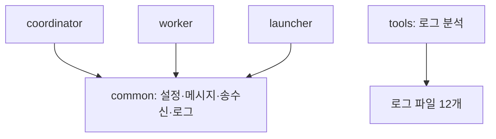

# HW3 - Fault-Tolerant 협업 Worker Ring

2026학년도 2학기 데이터통신 2조. **Python으로 확정**, HW2 코드는 재사용하지 않고 새로 구현한다.
현재 상태: 설계 완료, 프로그램 구현 전. 제출 기한: **2026-10-26(월) 23:59**.

## 1. 설계 방향

**프로세스별로 담당을 나누고, 담당 간 연결은 TCP 메시지로 제한한다.** Coordinator·Worker·Launcher는 서로의 Python 모듈을 import하지 않는다. 내부 상태·Lock·Queue도 각자 관리한다.

공통 패키지는 설정값·메시지·줄 단위 송수신·로그만 제공한다. Task 소유권·Worker 생사·crash 스케줄 같은 업무 상태는 공통으로 옮기지 않는다. 공통 규약을 먼저 고정하고, 상대 프로그램은 담당별 TCP 대역으로 대체해 독립 개발한다.

실행 기준은 **Python 3.12 이상, 표준 라이브러리만 사용**하는 설계안이다. Coordinator의 Dispatcher는 `threading.Thread` 6개를 직접 생성한다. 기본 Thread Pool 크기나 요청별 스레드 생성에 의존하지 않는다. 테스트는 `unittest`를 사용한다.

| 프로그램 | 위치 | 담당하는 원본 데이터 |
| --- | --- | --- |
| Coordinator | 별도 물리적 원격 호스트 | Task의 state·owner·epoch·result·commit_count, Worker의 HB 기반 생존 상태 |
| Worker 10개 | 동일 로컬 PC의 독립 프로세스 | 자기 실행 상태·로컬 Task Queue·CKPT Store·crash_gen |
| Chaos Launcher | Worker와 같은 로컬 PC | 프로세스 핸들·제어 연결·무작위 장애 스케줄·CRASHED/REJOINING 수 |

## 2. 3인 역할 배분

기존 GitHub의 조원 명단을 기준으로 배분한다. HW2의 담당 범위는 이번 구현에 이어 붙이지 않는다.

| 담당 | 주 담당 범위 | 소유 경로 | 독립 검증 상대 |
| --- | --- | --- | --- |
| **안선효** | Coordinator 전체, 원격 배포, 최종 통합 | `hw3/coordinator/`, `tests/coordinator/` | 본인이 작성한 TCP fake Worker 10개 |
| **황대겸** | Worker 전체, 소수 계산, CKPT·crash·재합류 | `hw3/worker/`, `tests/worker/` | 본인이 작성한 TCP fake Coordinator·Buddy·Launcher |
| **황왕석** | 공통 규약 구현, Launcher, 로그 분석·통합 시나리오 | `hw3/common/`, `hw3/launcher/`, `hw3/tools/`, 해당 tests | 본인이 작성한 TCP fake Worker, 합성 로그 |

작업량은 Coordinator의 동기화·FD, Worker의 계산·상태 경쟁, Launcher의 스케줄·공통 통신·검증 도구로 나눴다. 공통 모듈 작성은 황왕석의 첫 작은 작업으로 끝내고, 이후 Launcher와 검증을 진행한다.

### 안선효: Coordinator

- Listener 1개, Dispatcher 6개, Failure Detector 1개, Main으로 구성한다. POOL은 Listener에서 5초마다 기록하고 추가 Monitor는 두지 않는다.
- HELLO·RING_OK 등록 완료를 Main의 CV로 기다려 RING·START를 전송한다. START 시각으로 lastHB를 초기화하고 FD를 시작한다.
- Listener는 Socket별 줄 버퍼를 관리하고 HB를 직접 반영한다. 나머지 요청은 Request Queue에 넣는다.
- Worker Table Lock 안에서 DEAD 확인·PENDING 꺼내기·Task 배정을 함께 처리한다.
- Task별 Lock 안에서 RESULT의 DONE·epoch·owner 검사와 Commit을 함께 수행한다.
- FD는 새 DEAD를 먼저 모두 표시한 뒤, 각 DEAD Worker 소유의 **모든 ASSIGNED Task**를 다음 ALIVE로 인계한다.
- Main이 마지막 Commit 통지를 받아 VERIFY·BYE·스레드 종료·join을 수행한다.
- 담당 검증: 기동 차단, 중복 Commit·stale 결과, REQ/FD 경쟁, 동시 DEAD의 대상 선정, 재인계·종료. 대역 검증은 상태 전이와 정합성에 한정하며 최종 소수 합계는 실제 Worker와 확인한다.
- 반환물: 담당 소스·테스트, 스레드/Lock 구조 설명, 실행 명령, 검증 결과·남은 문제, 원격 배포 정보.

### 황대겸: Worker

- 프로세스 하나에 Control Recv·Compute·Heartbeat·Peer Server를 둔다. Compute는 하나로 Task를 차례로 계산한다.
- 구간 체로 소수를 계산한다. 진행 중 Task를 먼저 끝내고 인계 Task는 FIFO로 처리한다.
- CKPT는 고정 Buddy로만 보내며 Store는 Task별 최신 `(epoch, step)` 하나를 유지한다.
- CRASH에서 Queue·진행 Task·Store·requested·no_task를 지우고 TCP를 유지한 채 침묵한다.
- RESTART→REJOIN→WELCOME 후 HB·계산을 재개하고 새 Task를 요청한다. Worker가 epoch를 직접 증가시키지 않는다.
- 전송과 crash 전환, 수신 핸들러와 상태 초기화의 경쟁을 Worker 내부에서 해결한다. 상세 경계는 7절을 따른다.
- 담당 검증: 소수 누적값, CKPT 재개/소실, 반복 crash, 전송 직전 crash, READY 지연, NO_TASK 이후 TAKEOVER, CRASHED 중 BYE.
- 반환물: 담당 소스·테스트, 초기화 목록·송신 보장 설명, 재개 step 로그, 검증 결과·남은 문제.

### 황왕석: 공통·Launcher·검증

- 4절의 공통 API를 작은 모듈로 구현하고 분할/결합 메시지·송신 직렬화·로그 형식을 먼저 검증한다. 공통 모듈은 스레드를 생성하지 않는다.
- Launcher가 `subprocess.Popen`으로 Worker 10개를 직접 실행한다. Worker 클래스를 import하거나 같은 프로세스의 스레드로 실행하지 않는다.
- READY 10개 후 t0를 잡고 무작위 장애를 주입한다. CRASHED+REJOINING이 2개면 REJOINED까지 기다린 뒤 간격을 새로 추첨한다.
- 제어 연결 EOF를 EXITED로 처리하고 예정 RESTART를 취소한다. 모든 Worker 종료 후 Launcher를 종료한다.
- 로그 분석기는 프로그램 객체 대신 저장된 로그 12개를 입력받는다. 조원 소스를 호출하지 않고 합계·Commit·장애 회차·지표를 검증한다.
- 담당 검증: 재현 가능한 난수 호출 순서, 동시 장애 상한, 80초 이후 주입 중단, EOF·종료, 불완전/불일치 로그 검출.
- 반환물: 담당 소스·테스트, 모든 로그 명세, 검증 도구·분석 표, 검증 결과·남은 문제.

## 3. 제안 패키지·파일 구성

아래는 **구현할 파일 구조**다. 이번 변경에서는 README 설계만 작성했고 소스 파일을 생성하지 않았다. 각 패키지에는 `__init__.py`를 둔다.

```text
HW3/
├─ README.md
├─ hw3/
│  ├─ __init__.py
│  ├─ common/                    # 황왕석: 업무 상태 없이 공통 규약만
│  │  ├─ settings.py             # 고정 수치·실행 설정의 불변 데이터
│  │  ├─ protocol.py             # Message, encode/parse, 필드 검증
│  │  ├─ transport.py            # LineBuffer, 송신 Lock·부분 쓰기 처리
│  │  └─ log.py                  # 노드별 파일·공통 로그 형식
│  ├─ coordinator/               # 안선효
│  │  ├─ __main__.py             # CLI → app 실행
│  │  ├─ app.py                  # 구성·기동·Ring·VERIFY·BYE·join
│  │  ├─ tables.py               # Task/Worker Table·PENDING·Lock·지표
│  │  ├─ listener.py             # select 감시·직접 HB 처리·Queue 적재
│  │  ├─ dispatcher.py           # 고정 6개, 배정·결과·재합류 처리
│  │  └─ detector.py             # 1초 FD·다음 ALIVE·전체 소유 Task 인계
│  ├─ worker/                    # 황대겸
│  │  ├─ __main__.py             # CLI → app 실행
│  │  ├─ app.py                  # 구성·스레드·READY·정상 종료
│  │  ├─ state.py                # 상태·crash_gen·Queue·Store·CV
│  │  ├─ network.py              # Control Recv·Peer Server·송신 경계
│  │  ├─ heartbeat.py            # RUNNING에서만 1초 HB
│  │  ├─ compute.py              # step 계산·CKPT·RESULT·다음 REQ
│  │  └─ primes.py               # 작은 소수·구간 체·step 범위
│  ├─ launcher/                  # 황왕석
│  │  ├─ __main__.py             # CLI → app 실행
│  │  ├─ app.py                  # 제어 연결·READY/REJOINED/EOF·종료
│  │  ├─ processes.py            # Worker 명령 작성·Popen·핸들 관리
│  │  └─ chaos.py                # RNG·상태 표·crash/restart 시각 결정
│  └─ tools/                     # 황왕석
│     └─ verify_logs.py          # 동일 실행 로그·장애별 지표 검사
└─ tests/
   ├─ coordinator/               # 안선효: 테스트와 자기 TCP 대역
   ├─ worker/                    # 황대겸: 테스트와 자기 TCP 대역
   ├─ common/                    # 황왕석
   ├─ launcher/                  # 황왕석: 테스트와 자기 TCP 대역
   └─ integration/               # 황왕석 시나리오, 각 담당이 자기 오류 수정
```

파일 수를 줄이려면 같은 담당의 파일만 합칠 수 있다. 예를 들어 launcher의 `processes.py`는 `app.py`에 합칠 수 있지만 Worker 상태나 Coordinator 테이블을 공통 패키지로 합치지 않는다.

## 4. 최소 공통 계약과 의존성



Coordinator↔Worker, Worker→Buddy, Launcher↔Worker는 TCP로만 연결한다. Launcher↔Coordinator 연결은 없다. `common`은 다른 HW3 패키지를 import하지 않고 소유권·생존 상태·전역 Queue를 갖지 않는다.

공통 API 이름과 동작은 아래를 먼저 고정한다. 구체적 클래스 내부는 담당자가 결정한다.

| 모듈 | 고정할 계약 | 경계 |
| --- | --- | --- |
| settings | 과제 상수 + 읽기 전용 실행 설정 | Task 크기·Worker 수·타임아웃을 한 곳에서 정의. 살아 있는 상태를 넣지 않음 |
| protocol | `Message(kind: str, fields: tuple[str, ...])`, `encode(message) -> str`, `parse(line) -> Message` | encode는 LF 없는 문자열 반환. 문법·필드 범위 검사만 하며 생존·epoch 유효성 판단은 각 프로그램 담당. 잘못된 문법은 `ProtocolError` |
| transport | `LineBuffer.feed(bytes) -> list[str]`, `send_line(socket, line, send_lock)` | feed는 미완성 줄을 보관. send_line은 LF 하나를 붙여 전체 바이트를 직렬화해 송신하며 업무 Lock을 받지 않음 |
| log | `NodeLogger(node, path, run_id)`, `write(event, status, fields)`, `close()` | 자기 파일 하나만 관리. 다른 노드의 파일을 지우거나 통계 상태를 변경하지 않음 |

공통 구현 전에도 각 담당은 같은 계약의 테스트 대역이나 TCP 스크립트로 개발한다. 공통 모듈 1차 완료 후 API를 고정하고 직접 사용하는 호출부로 교체한다. 테스트 대역은 `tests/`에만 두고 제품 실행에 연결하지 않는다.

공통 API 변경은 이유·영향 경로·수정할 호출을 PR에 기록한다. 각 담당 소유 파일은 해당 담당이 수정하고, 팀장이 공통 규약 변경과 최종 통합을 확인한다.

### settings의 고정 수치

| 항목 | 정식 값 |
| --- | --- |
| Worker / Dispatcher | 10개 프로세스 / 6개 고정 스레드 |
| Task / step | Task 1,000개, Task당 수 100,000개; step 10개, step당 수 10,000개 |
| step 범위 | `lo=k*100000+(s-1)*10000+1`, `hi=lo+9999`, 양 끝 포함 |
| Buddy / Peer 포트 | `i mod 10 + 1` / `7000+i` |
| HB / FD / POOL | 각각 1초 / 1초 / 5초 |
| SUSPECT / DEAD | 마지막 HB 후 3초 이상 / 5초 이상 |
| 첫 CRASH / 이후 간격 | READY 10개 시각 t0 후 10~20초 / 직전 CRASH 후 5~15초 |
| RESTART / 주입 종료 | CRASH 후 10~15초 / t0 후 80초부터 새 CRASH 없음 |
| 재접속 / REJOIN 재시도 | 접속 거절 후 0.5초 / RETRY_LATER 후 2초, 아직 REJOINING일 때만 |
| 정식 step delay / 예상 합계 | 100ms / 5,761,455 |

소수 함수의 검증값: 작은 소수 1,229개·마지막 9,973, Task 0=9,592·152=6,075·160=5,989·271=5,802. step별 누적값도 공식 명세와 대조한다.

## 5. 프로세스 사이의 통신 규약

Socket별 UTF-8 수신 버퍼로 LF 단위 메시지를 자른다. 한 recv에 여러 줄 또는 일부 줄만 와도 처리한다. 문법은 과제 예제를 그대로 사용한다.

| 방향 | 메시지 |
| --- | --- |
| Worker→Coordinator | `HELLO i ip port`, `RING_OK i`, `HB i`, `REQ i`, `RESULT k e v`, `REJOIN i` |
| Coordinator→Worker | `RING j ip port`, `START`, `ASSIGN k e`, `NO_TASK`, `TAKEOVER k e from=d`, `ACK k`, `REJECT_STALE k reason`, `WELCOME`, `RETRY_LATER`, `BYE` |
| Worker→Buddy | 연결 첫 메시지 `PEER i`, 이후 `CKPT k e s partial` |
| Launcher→Worker | 연결 첫 메시지 `LAUNCHER`, 이후 `CRASH`, `RESTART` |
| Worker→Launcher | `READY i`, `REJOINED i` |

범위: Worker i·j·d=1~10, Task k=0~999, epoch e≥1, CKPT s=1~9. ASSIGN epoch=1, TAKEOVER마다 Coordinator가 +1. RESULT 거부 순서는 DEAD→DONE→EPOCH이며 owner 불일치도 EPOCH로 거부한다.

Coordinator는 HELLO로 등록한 **도착 Socket**으로 메시지를 보낸 Worker를 판별한다. Worker는 타 Worker 생사를 판단하지 않으며 CKPT 경로와 HB 장애 판정을 섞지 않는다.

Worker의 다음 REQ는 RESULT 송신 후 진행 Task·대기 Queue가 모두 없고 requested·no_task가 모두 False일 때 한 번만 보낸다. ASSIGN·NO_TASK에서 requested를 내린다. CKPT는 step 1~9 완료 뒤, RESULT는 step 10 완료 뒤 보낸다. 인계는 DEAD·SUSPECT를 건너뛴 다음 ALIVE이며, ALIVE가 전혀 없으면 첫 SUSPECT라는 명세의 예외 규칙을 적용한다.

### 실행 명령 규약: 구현 예정

명령은 `HW3` 폴더에서 실행한다. 아직 소스가 없어 아래 명령의 실행을 검증하지 않았다. IP·포트·seed는 인자로 전달한다. `run_id`는 양쪽에서 같은 값을 수동 지정해 동일 실행 로그를 묶는다.

```bash
# 원격 호스트
python -m hw3.coordinator --host 0.0.0.0 --port 9000 --run-id hw3-run01 --log-dir logs/hw3-run01

# 로컬 PC: Launcher가 Worker 10개를 실행
python -m hw3.launcher --coord <REMOTE_IP>:9000 --workers 10 --peer-ip 127.0.0.1 --peer-base 7000 --step-delay 100 --seed 42 --run-id hw3-run01 --log-dir logs/hw3-run01

# Launcher가 내부적으로 실행하는 Worker 명령 예
python -m hw3.worker --id 1 --coord <REMOTE_IP>:9000 --peer-ip 127.0.0.1 --peer-port 7001 --step-delay 100 --run-id hw3-run01 --log-dir logs/hw3-run01
```

Launcher는 자신의 `sys.executable`을 사용하고 명령 인자를 리스트로 전달한다. Worker 경로·클래스를 import하지 않으므로 테스트에서는 자기 fake Worker 명령으로 교체해 독립 검증할 수 있다.

## 6. 로그 계약과 검증 담당의 독립성

형식은 `[HH:MM:SS.mmm] NODE | EVENT | STATUS | message`, 시간대는 KST로 통일하는 설계안이다. 타임아웃·지연 계산에는 각 프로그램의 단조 시계를 사용하고, 로그 간 대조에는 동기화한 실제 시각을 사용한다.

`message`는 JSON 객체로 기록한다. 모든 행에 `run_id`와 `ts_unix_ms`를 넣고 이벤트별 필드를 추가한다. 이 방식으로 검증 도구가 문장이나 필드 순서에 의존하지 않도록 한다. 파일은 `Coordinator.txt`, `Worker1.txt`~`Worker10.txt`, `Launcher.txt`다.

| EVENT | 최소 필드 |
| --- | --- |
| INIT / START | node·설정값 / 시작 시각·ring_ready |
| ASSIGN | task, epoch, worker |
| CRASH / RESTART | worker, 해당 Worker의 장애 회차, down 목록 / worker |
| SUSPECT / DEAD | worker, last_hb_elapsed_ms, elapsed_ms; DEAD는 owned_tasks, to_worker, dead_now |
| TAKEOVER (Coordinator) | task, old_epoch, epoch, from_worker, to_worker |
| TAKEOVER (Worker) | task, epoch, from_worker, ckpt_epoch, resume_step |
| RESULT / COMMIT | task, epoch, worker, result; COMMIT은 commit_count |
| REJOIN / WELCOME | worker, rejoin_count |
| REJECT_STALE | task, epoch, worker, reason |
| POOL / VERIFY | queue·pending·assigned·done·alive / done·commits·double_commit·sum·pass |

RING·CONNECT·CKPT·HB·TERMINATE와 추가 이벤트도 `AllDefinedLogs.txt`에 정의한다. Launcher 장애 회차와 Coordinator 감지 회차는 **Worker 번호와 반복 순서**로 대조한다. Coordinator가 Launcher의 crash 스케줄을 알게 만들지 않는다.

Coordinator의 elapsed_ms와 last_hb_elapsed_ms는 START 시각을 0으로 한 같은 단조 시계 기준이다. 감지 지연은 두 값의 차이로 계산한다. Worker의 재개 로그가 없는 TAKEOVER는 CKPT 절약률 분자에 0을 더하고 인계 Task 수에는 포함한다.

검증 도구는 1,000 DONE·각 commit_count=1·합계 5,761,455·COMMIT 1,000개·CRASH/DEAD/승인 REJOIN 수 일치·동시 장애 최대 2개·재합류 후 새 Task를 검사한다. 복구 시간은 재인계까지 추적한 최종 Commit을 기준으로 하고, CKPT 절약률은 Worker의 resume_step에서 계산한다.

## 7. 핵심 동기화·장애 경계

- Coordinator Lock 순서: Worker Table→Task(오름차순). Task마다 독립 Lock을 만들고 상태 Lock 밖에서 send한다.
- Worker Lock 순서: Queue→state→Store. 수신 처리의 상태/세대 확인과 Queue·Store 변경 사이에 CRASH가 끼어들지 않도록 보호한다.
- Worker는 Task를 꺼낸 순간의 crash_gen을 기억한다. Compute·HB·REQ 등 정상 송신은 같은 세대이고 RUNNING일 때만 허용한다.
- **송신 직전 확인만으로는 충분하지 않다.** Worker의 송신 전용 직렬화 경계를 CRASH 전환과 공유한다. 송신 경계 안에서 state/세대를 확인하고 state Lock을 푼 뒤 전송한다. CRASH는 같은 경계에서 진행 중 송신이 끝난 뒤 CRASHED 전환·초기화를 수행한다. 네트워크 I/O 동안 Queue·state·Store Lock은 보유하지 않는다. 송신 무한 대기는 유한 타임아웃으로 제한한다. 이 방법은 설계안이며 경쟁 테스트로 확인해야 한다.
- 송신 경계는 Queue·state·Store Lock 밖에서 진입한다. CRASH 처리의 중첩 순서는 송신 경계→Queue→state→Store로 고정한다. 공통 send_line의 Socket 송신 Lock과 Worker의 상태 전환 경계는 별개로 두어 동일한 비재진입 Lock을 두 번 잡지 않는다.
- Buddy CKPT 송신 오류는 WARN 후 계산을 계속하고 Coordinator 연결 오류는 치명적 오류로 기록한다. CRASH 판정은 EOF로 대체하지 않는다.
- CRASHED에서는 받은 메시지를 읽고 버리되 RESTART·BYE는 처리한다. REJOINING에서는 CKPT를 저장하고 REJOIN을 보내지만 Compute·HB는 WELCOME까지 대기한다.
- NO_TASK 후에는 인계 Task를 처리해도 새 REQ를 보내지 않는다. crash에서 no_task를 초기화하므로 재합류 후 REQ 가능하다.
- READY는 START 수신과 Launcher 연결이 모두 갖춰진 순간 한 번 전송한다. BYE는 CRASHED 상태에서도 모든 CV 대기를 깨워 종료한다.

연속 Buddy 검증은 W4→W5뿐 아니라 **W10→W1**도 포함한다. W4 작업 A를 W5에 인계한 뒤 W5까지 죽으면 W5의 원래 작업 B와 인계 작업 A를 모두 다음 ALIVE에 다시 넘긴다. A는 epoch 1→2→3으로 진행하고, CKPT가 사라졌으면 처음부터 계산한다.

## 8. 개발 순서와 완료 기준

| 단계 | 세 사람이 독립적으로 할 작업 | 완료 기준 |
| --- | --- | --- |
| 0. 공통 규약 고정 | 팀장 규약 확인, 황왕석 공통 최소 구현; 나머지는 상태·계산·TCP 대역 개발 | 메시지·공통 API·CLI·로그 필드 동일, 공통 모듈에 업무 상태/추가 스레드 없음 |
| 1. 기본 구현 | Coordinator 배정/Commit, Worker 계산/CKPT, Launcher 프로세스/제어 | 각 담당의 독립 테스트 통과, 기동/정상 계산/종료 경로 구현 |
| 2. 장애 구현 | FD·전체 소유 Task 인계 / crash·재합류 / RNG·동시 상한 | 단일·반복·이웃 장애의 독립 테스트 통과 |
| 3. 통합 | 실제 프로그램 3종 연결, 담당별 자기 오류 수정 | 로컬 1,000 Task와 경계 경쟁 검사 통과, 누락·이중 Commit 없음 |
| 4. 제출 실행 | 안선효 원격 배포, 황대겸 재개 로그 확인, 황왕석 지표 분석 | 원격 + delay 100에서 동일 실행 로그 12개, 정합성 PASS, 문서·영상·ZIP 검증 |

독립 완료 후 통합할 때까지 대기하지 않는다. Coordinator는 다른 구현 없이 메시지를 주입해 epoch·owner 경합을 확인하고, Worker는 가짜 제어 서버로 계산·초기화를 확인하며, Launcher는 가짜 Worker로 장애 상한·종료를 확인한다. 정식 PASS는 실제 세 프로그램으로 얻는다.

## 9. Git 작업 범위와 현재 저장소 확인

2026-10-13 기준, 작업 시작점 `45c2851e5e7e5cb08f262a151cb608bc59be3d67`에서 확인한 현황이다.

- main 추적 파일 26개: HW1 Python 소스 6개, HW2 Java 소스 13개, README·제출 설명·로그 명세·gitignore. 전체 파일 목록, 소스의 import·클래스·공개 함수 구조, README의 역할·실행·협업 지침을 확인했다.
- 원격 브랜치 23개, PR 25개 중 24개 병합·1개 열림. 별도 일반 이슈는 없고 원격 태그·릴리스도 없다. main에 Actions 워크플로 파일·AGENTS.md는 없다.
- HW2 개발 완료는 사용자가 확인했다. GitHub README에 남은 실측 빈칸을 새 측정값으로 채우거나 이번에 실행 성공했다고 판단하지 않았다.
- [열린 PR #25](https://github.com/He6venly/Data_Communication/pull/25)는 HW2 README·제출 준비 안내다. HW3 설계와 별개이므로 이번 변경에 섞지 않는다.
- HW2 README 14절의 지침: “기본 브랜치 직접 반영과 자동 병합은 하지 않는다.” 이후 작업은 기능별 브랜치와 한글 PR로 제출한다. 팀장 통합 확인 후 main에 반영한다.

작업 브랜치 제안: `hw3/coordinator`, `hw3/worker`, `hw3/launcher-common`. 각자 자기 소유 경로만 커밋하고 PR에 변경·실행 명령·검증 결과·한계를 기록한다. 공통 README는 팀장이 취합한다. 로그·영상·실행 산출물·개인 환경은 제출 자료로 따로 관리한다.

이번 변경은 Python 확정·설계·역할 배분 문서다. HW1·HW2 소스의 버그 검증, HW3 프로그램 구현·실행·원격 성능 측정은 수행하지 않았다.

## 10. 제출물

전체 Python 소스, `Readme.txt`, `AllDefinedLogs.txt`, 동일 원격 실행 로그 12개, 약 5분 시연 영상의 다운로드 링크가 담긴 `download.txt`를 `G2HW3.zip`으로 제출한다. Readme에는 조원·역할, 배포·실행 명령·시간대·seed, 장애 처리·동기화 설계, 실측 지표·정합성 결과를 기록한다.

설계에 사용한 표준 기능: [Python Thread·Lock·Condition](https://docs.python.org/3.12/library/threading.html), [selectors](https://docs.python.org/3.12/library/selectors.html), [subprocess](https://docs.python.org/3.12/library/subprocess.html). 과제 요구는 로컬의 공식 과제 PDF와 교수님 별도 설명을 기준으로 했다.
