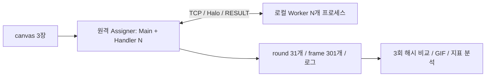

# HW4 분석 및 실행 계획

작성일: 2026-10-27 · 2조(G2, team=2) · 마감: **2026-11-09(월) 23:59**

현재 단계는 자료 분석·개발 준비다. 아래 구현·배포·실측·제출 항목은 앞으로 할 일이며, 완료 결과가 아니다. **필수**는 공식 명세, **제안**은 설계 선택, **확인 결과**는 실제 자료 검사로 구분한다. HW1~HW3 완료 표시는 사용자의 지시에 따른다.

## 1. 먼저 확인한 과제 해석

**우리 조만의 ASCII 글자 그림 세 장을 만든다는 해석은 맞다. 다만 그림은 입력이고, 핵심 구현은 그 그림을 여러 Worker가 함께 진화시키는 TCP 분산 시스템이다.**

- `canvas0.txt`: 처음 상태 S(0).
- `canvas1.txt`: Round 1000 계산 직전 기존 그림 위에 덧칠할 입력.
- `canvas2.txt`: Round 2000 계산 직전 기존 그림 위에 덧칠할 입력.
- 프로그램 산출물: 100 Round 간격 그림 31개, 10 Round 간격 frame 301개, GIF, 해시 비교 결과, 로그·성능 지표.

‘우리 조를 소개하는 내용’은 가능한 표현 방향이지 필수 주제는 아니다. 필수는 **각 그림의 조 이름 + 조 이름 외 문구 2개 이상**, 그림마다 다른 문구·배치다. 조원 이름·성격·역할을 반드시 표현하라는 요구는 없다. 한글은 사용할 수 없다.

사용자가 말한 G11 예시는 현재 자료의 `HW4_student_pack/3_G11_sample/`이다. 이 폴더는 샘플 입력과 실제 결과 모음이다. 함수 틀은 `1_rule_test_kit/`, 검사·GIF 도구는 `2_tools/`에 따로 있다. **Assigner/Worker 완성 소스는 제공되지 않았고, myrules의 규칙 함수도 미구현 상태**다. canvas 생성 코드는 강의자료 19~21쪽의 예시이며 독립 소스 파일로 배포되지 않았다.

근거: 공식 명세 1~5, 11, 15쪽; 강의자료 15~24, 48~60쪽; 배포 README.

## 2. 자료 확인 결과

공식 명세 `HW4description.pdf` 15쪽, 강의자료 `HW4explanation.pdf` 120쪽을 확인했다. 배포팩은 88개 파일이다. 개별 파일 목록과 검사 결과는 [자료점검](자료점검.md)에 기록했다. 자료가 충돌하면 공식 명세를 우선한다.

| 자료 | 역할 | 확인 결과 |
| --- | --- | --- |
| 배포팩 README 2개·tests.txt | 구성·사용법·규칙 정답 | 규칙 일괄 테스트 10개. 덧칠·변환·띠 테스트는 별도 모드로 추가 실행해야 함 |
| Python/Java/C 규칙 키트 | 규칙 구현 틀과 테스트 실행기 | 6개 핵심 함수 직접 구현 필요 |
| Python/Java/C 도구 12개 | canvas 검사·round 검증·해시 비교·GIF | 재사용 가능. 언어별 코드를 검토했으며 Java/C 컴파일은 이번에 수행하지 않음 |
| G11 canvas 3개 | 입력 예시 | 모두 형식·문자·점 비율·획 기준 통과 |
| G11 round 파일 31개 | 분산 N=6 결과 | 31개 모두 12,880바이트, 계산 해시와 기록 일치 |
| G11 RoundHash 3개 | N=1/6/7 기준 | 31개 항목 모두 일치 |
| G11 hash_result | 제출 형식 예시 | 실제 샘플 해시와 대조 |
| GIF 2개 | 진행 모습 | 두 파일은 동일 바이트. 각각 301프레임·1000×830, 전 프레임 디코딩 확인 |
| hash.bat | Windows 해시 앞 8자리 출력 | 코드 확인. 경로 인용이 없어 공백 경로 사용에 주의; 계획에서는 Python hashlib 사용 |
| PEM 파일 | 서버 접속용 키 | 존재만 확인. 과제 안내가 아니므로 비밀값 열람·Git 업로드 제외 |

샘플 canvas의 점 비율/획 수는 순서대로 **5.16%/576, 4.94%/487, 4.89%/471**이다. 이는 교수님 샘플의 검증이며 우리 프로그램의 통과 결과가 아니다. 샘플 round 파일의 정합성만 확인했으며 3,000 Round를 새로 계산한 것은 아니다.

## 3. 언어 비교와 추천

**추천: Python. 확정 지시가 아닌 권장안이며, 폴더는 언어 교체가 가능하게 구성한다.**

| 기준 | Python | Java |
| --- | --- | --- |
| 개발·수정 | 제공 Python 키트와 연결이 간단하고 canvas·해시·검증 코드를 짧게 작성 가능 | 타입 검사를 컴파일 때 받으며 배열·메시지 자료형을 명확하게 구성 가능 |
| 동기화 | `Thread`, `Lock`, 동일 Lock을 쓰는 `Condition` 2개 | `Thread`, `ReentrantLock`, `newCondition()` 2개 |
| 계산 | 반복문 비용이 상대적으로 클 수 있음. 실제 시간은 측정 필요 | 계산 루프·Worker 내부 병렬화 성능에 유리할 가능성. 실제 비교 미실시 |
| GIL/병렬성 | 일반 CPython에서 한 프로세스의 CPU 스레드 병렬성에 제약. 이 과제는 Worker가 별도 프로세스여서 구조상 대응 가능 | Worker 내부 계산 스레드 확장을 검토하기 편함 |
| 준비·의존성 | 핵심 프로그램은 표준 라이브러리로 가능. 제공 GIF 도구는 Pillow 필요; FIGlet 사용 시 pyfiglet 추가 | JDK·컴파일·클래스 경로 관리 필요. 제공 GIF 도구는 JDK 표준 API만 사용 |
| 팀 경험 | 기존 HW3가 Python이므로 팀 경험을 이어가기 좋음 | 기존 HW2의 Java 경험 활용 가능 |
| 주의점 | 런타임 오류, 느린 칸별 계산, LF·공백 보존 확인 필요 | 코드량·예외 처리·컴파일 환경 관리 부담, LF·인코딩 명시 필요 |

추천 이유는 완성도와 검증 편의다. Assigner는 주로 통신·대기하고 계산은 독립 Worker 프로세스가 맡는다. 강의자료 116쪽도 이 구조에서 Python GIL을 주요 장애로 보지 않는다. HW3의 장애 감지·Ring·Dispatcher Pool을 그대로 재사용하면 이번 필수 구조와 충돌하므로, 언어 경험만 활용하고 Assigner는 새로 만든다.

제안 환경은 Python 3.12 이상, 핵심 프로그램은 표준 라이브러리, GIF 제작에만 Pillow다. 최신 버전이나 최고 성능을 요구하는 명세는 없다. Java 선택 시 배포 예제는 Java 8 이상을 대상으로 한다. Python 기본 기능은 [공식 threading 문서](https://docs.python.org/3/library/threading.html), Java의 Lock 연계 CV와 while 대기는 [공식 Condition 문서](https://docs.oracle.com/en/java/javase/21/docs/api/java.base/java/util/concurrent/locks/Condition.html)를 참고했다.

## 4. 반드시 지켜야 할 요구사항

| 항목 | 필수 조건 | 확인 방법 |
| --- | --- | --- |
| 배포 | 외부 서버 Assigner 1개, 로컬 PC 한 대에 Worker N개 프로세스 | 실제 실행 로그·시연 |
| 연결 | TCP Star 구조, Worker 간 직접 통신 금지 | 연결 코드·소켓 구성 검사 |
| N | 정식 분산 실행마다 4~8 무작위. 비교할 두 실행의 N은 달라야 함 | INIT·실행 설정 확인 |
| 분할 | k=0~N-1, 행 `[80*k//N, 80*(k+1)//N)` | N=4~8 경계·누락·중복 검사 |
| 스레드 | Assigner Main 1개 + 접속 단계에서 생성한 Handler N개 | 추가 풀·모니터·로그 스레드 금지 |
| Barrier | 공유 상태 Mutex 1개 + done_cv/go_cv 2개. RESULT N개 뒤 다음 Round | while 재확인, 순서 검사 |
| I/O | 공유 Lock 안에서 send/recv/파일 저장 금지 | 복사본으로 Lock 밖 I/O |
| Worker | 자기 띠와 Halo 두 줄; cur/next 이중 버퍼 | 전체 canvas를 Worker마다 복제하지 않음 |
| 설정 | IP·포트·team·canvas 경로를 인자/설정으로 받음 | 하드코딩 검사 |
| 오류 | r/k 불일치·연결 끊김은 FAIL 후 종료 | 모든 CV 대기 해제·소켓 종료·join 확인 |
| 진행 | Round 0~2999, 총 3,000회 | Assigner와 모든 Worker 처리 횟수 |

### canvas 세 장 공통 조건

1. 정확히 80줄 × 160글자. ASCII 32~126만 사용. 탭·한글·이모지·CR·BOM 없음.
2. 마지막 줄까지 LF. 파일당 **12,880바이트**. 줄 앞뒤 공백을 제거하지 않는다.
3. 조 이름 G2와 별도 문구 2개 이상을 높이 5줄 이상의 큰 ASCII 글자로 표현한다.
4. 글자 배치 후 빈칸마다 5% 확률로 `.`을 뿌린다. `점/(점+공백)`은 **4~6%**여야 한다.
5. 공백과 점을 제외한 글자 획이 **384칸 이상**이어야 한다.
6. 조 이름을 제외한 문구와 배치는 세 그림에서 서로 다르게 한다.
7. 수치 검사는 check_canvas, 문구·큰 글자 높이·다른 위치는 사람이 확인한다.

### 규칙·전환·저장 시점

| Round | 규칙 | 계산 직전 처리 |
| --- | --- | --- |
| 0~999 | Text Life: 공백 아닌 칸은 생존 이웃 2/3, 빈칸은 이웃 3에서 탄생. 부모 최빈 문자, 동률 ASCII 최소 | 최초 canvas0 |
| 1000~1999 | Brian: `@ → + → 공백`, 공백은 이웃 `@`가 정확히 2개면 `@` | 1000에만 canvas1 덧칠 → 공백 아닌 칸을 `@`로 |
| 2000~2999 | Cyclic: `RAMP=" .:-=+*#%@"`, 상하좌우 중 다음 단계가 있으면 한 단계 진행 | 2000에만 canvas2 덧칠 → 단계 변환 |

Rule1/2는 8이웃, Rule3는 4이웃이다. 판은 좌우·상하 Torus. 덧칠은 canvas의 공백·점을 제외한 칸만 복사한다. 단계 변환은 RAMP의 공백 아닌 문자는 유지하고 나머지(공백 포함)를 `(7*x + 3*y + (x*y)%11 + team)%10`으로 바꾼다. `y=(y0-1+i)%80`은 작업판 행이 아닌 전체 판의 행이다.

**전환은 Worker의 작업판 전체(h+2줄), 즉 Halo에도 적용한다.** `round1000.txt`와 `round2000.txt`는 덧칠 전 S(1000), S(2000)이다. Round r 결과는 S(r+1)이므로 frame 송신 조건은 `r%10==0`이 아니라 **`(r+1)%10==0`**이다.

## 5. 구현 구성과 공통 통신 규약



| 메시지 | 방향 | 뒤따르는 그림 줄 |
| --- | --- | --- |
| `HELLO` | Worker → Assigner | 없음 |
| `ASSIGN k N y0 y1 team` | Assigner → Worker | canvas0 h줄 + canvas1 h+2줄 + canvas2 h+2줄 |
| `ROUND r` | Assigner → Worker | top, bottom 두 줄 |
| `RESULT r k` | Worker → Assigner | 새 첫 줄·끝 줄, 매 10회에는 띠 h줄 추가 |
| `BYE` | Assigner → Worker | 없음 |

접속 순서로 k를 배정한다. 그림 줄은 정확히 160글자이며 끝의 LF만 제거한다. TCP 분할 수신·여러 메시지 합쳐 수신을 지원한다. 첫·끝 줄과 전체 띠가 중복되어도 명세대로 모두 전송한다.

제안 모듈: `src/assigner/`는 Main·Handler·Barrier·저장·측정, `src/worker/`는 수신·규칙 계산·전환·결과 송신, `src/common/`은 메시지·LF 입출력·로그, `tools/`는 canvas 생성·검증·GIF·실행 보조다. 지금은 폴더만 만들고 구현 파일은 언어 선택 후 작성한다.

제안 Worker는 단일 스레드다. 필수 요구 충족과 디버깅 단순화가 이유다. 내부 멀티스레드 가산점은 기본 정합성 확보 후 선택한다. HW3 Heartbeat·재접속·Chaos Launcher·Worker Ring은 이번 범위에 넣지 않는다. 실행 보조 스크립트는 Worker 프로세스만 띄우며 Assigner 스레드 수에 영향을 주지 않는다.

## 6. ASCII 제작 방향 제안

‘함께 연결하고 성장하는 2조’를 주제로 아래처럼 구성할 수 있다. **문구·좌표는 제안이며 아직 그림을 생성하지 않았다.**

| 그림 | 큰 글자 문구 | 배치 제안 (x,y) | 의미 |
| --- | --- | --- | --- |
| canvas0 | G2 / CONNECT / BUILD TOGETHER | (8,6) / (28,25) / (8,51) | 연결과 협업 |
| canvas1 | G2 / SHARE IDEAS / GROW AS ONE | (112,8) / (12,32) / (40,60) | 공유와 성장 |
| canvas2 | G2 / IN SYNC / BEYOND LIMITS | (65,5) / (10,22) / (30,46) | 동기화와 도전 |

직접 만든 높이 7줄 글꼴 또는 FIGlet을 사용한다. 겹침·잘림과 384칸 기준은 생성 후 검사하고 필요하면 획·배치를 조정한다. 배경 난수 seed는 고정해 같은 입력 파일을 재현한다. 샘플 G11에 조 번호만 바꾼 결과를 제출하지 않는다.

## 7. 개발 단계와 완료 기준

일정은 작업 순서 제안이며 확정된 팀원 배정이나 소요시간 보장이 아니다.

| 기간 제안 | 작업 | 완료 기준 |
| --- | --- | --- |
| 10/27~10/28 | 언어·역할 선택, canvas·입출력 규약 정리 | canvas 3장 수치+육안 검사 |
| 10/29~10/31 | 6개 규칙 함수, 키트, 통신 없는 기준 계산 | 10개 규칙 테스트 + 덧칠/변환/띠 별도 검사, G11 31개 해시 일치 |
| 11/01~11/03 | Assigner/Worker 실제 TCP 연결, N=1부터 N=4~8 | 전체 3,000회 결과가 기준 계산과 일치; 경계·오류 종료 검사 |
| 11/04~11/06 | G2 입력 확정, N=1 실행, 원격 무작위 분산 2회 | 동일 입력·team=2, a≠b, 세 실행 31/31 SAME |
| 11/07~11/08 | 성능 표·로그·GIF·Readme·시연 영상 | 같은 원격 실행의 round·로그·GIF, 영상 링크 확인 |
| 11/09 | ZIP 재검증·제출 | 새 위치에서 실행 가능, 압축 오류·누락 없음, 23:59 전 제출 |

담당 분할 후보는 A: Assigner·Barrier·원격 통합, B: Worker·규칙·키트, C: 공통 송수신·canvas·도구다. 문서·측정·시연 취합 책임자는 별도로 지정한다. HW3의 이름별 역할을 HW4에 자동 확정하지 않는다.

### 검증 순서

1. G11, team=11로 규칙부터 맞춘다. `tests.txt`만 ALL PASS라고 덧칠·변환·띠 검증까지 완료한 것으로 보지 않는다.
2. 덧칠 → brian → Rule2 한 회 결과를 각 정답 파일과 바이트 비교한다. cyclic은 ytop=25, team=11 결과를 비교한다.
3. N=3의 세 작은 띠 작업판 결과를 각각 비교하고 연결 결과가 Rule1 R1과 같은지 검사한다.
4. 샘플 전체 판 한 회 결과는 `2d651c01`, 3,000회 결과는 제공된 31개 해시와 비교한다.
5. 실제 TCP Assigner + Worker 1개로 N=1 기준을 만든다. 통신 없는 계산을 제출용 N=1로 대체하지 않는다.
6. 로컬 N=4~8에서 31개 해시를 비교한다. 특히 N=6/7의 서로 다른 띠 높이와 위아래 경계를 확인한다.
7. G2 입력과 team=2로 다시 실행한다. 정식 분산 실행은 `--n` 없이 무작위이며 같은 N이 나오면 재실행한다.
8. 세 실행 각각 verify_run으로 형식·기록 해시를 검사하고 make_hash_result로 비교한다. 별도로 N=1/a/b 범위·서로 다름·행 순서·누락·해시 문법을 검사한다.
9. 제공 도구는 PASS/FAIL 문자열만 출력하고 종료 코드로 실패를 구분하지 않는 경우가 있다. 자동화는 종료 코드 0만으로 통과 처리하지 않는다. make_hash_result도 N 범위를 보장하지 않는다.
10. Assigner/각 Worker 3,000회, frame 301개, GIF 실제 301프레임, 처음/마지막 그림, 같은 실행의 round와 frame 일치를 확인한다.

## 8. 로그와 실측 계획

필수 형식은 `[HH:MM:SS.mmm] NODE | EVENT | STATUS | message`. NODE는 ASSIGNER/WORKERk, STATUS는 SUCCESS/FAIL/INFO/WARN. EVENT는 INIT, CONNECT, ASSIGN, ROUND, RESULT, BARRIER, SAVE, REPAINT, TERMINATE를 포함하며 모든 추가 로그를 AllDefinedLogs.txt에 정의한다.

시간대는 **KST 제안**. 실제 시각을 출력하고 시간 측정에는 단조 시계를 쓴다. Worker 파일명은 배정받은 k로 `Worker{k}.txt`; ASSIGN 전 로그도 그 파일 앞부분에 보존한다. 100회마다 ROUND/RESULT/BARRIER를 요약하되 처리 횟수·전환·종료를 추적할 수 있어야 한다.

| 지표 | 측정·분석 |
| --- | --- |
| Round 시간 | Assigner Main 시작~전체 결과 도착 후 종료, 100회 단위 평균/최대 |
| 총시간·처리량 | 마지막 종료−Round 0 시작, `3000/총시간` |
| Barrier 대기 | Handler가 Lock 안에 기록한 최종 도착−최초 도착; 평균/최대·가장 늦은 Worker |
| Worker 계산시간 | ROUND 수신~RESULT 송신, 띠 높이와 비교 |
| 전송량 | 명령·그림·LF 포함 실제 바이트; 보통 Round와 전체 띠 전송 Round 구분 |
| 활동량 | 이전 저장 그림과 다른 칸 수, 선택 항목 |

실행마다 `n1`, `run1`, `run2` 아래에 결과와 로그를 묶어 보관한다. 실제 반복 실행은 새 식별자 하위 폴더를 사용해 덮어쓰지 않는다. `run-info`에는 N·team·입력 식별·명령·서버 환경·시각을 남기는 방식을 제안한다. 예시 시간·측정치를 실측으로 옮기지 않는다.

## 9. 사전 생성 폴더와 제출 구조

```text
G2HW4/
├─ HW4_student_pack/             교수님 원본, 보존
├─ HW4description.pdf 등         원본 안내·GIF·hash.bat, 보존
├─ 개발저장소/                   기존 GitHub 저장소의 새 로컬 복제본
│  ├─ HW1/ HW2/ HW3/             기존 과제 보존
│  └─ HW4/
│     ├─ README.md
│     ├─ docs/                   계획서·자료점검·제출 체크리스트
│     ├─ src/assigner/            Assigner 코드 예정
│     ├─ src/worker/              Worker 코드 예정
│     ├─ src/common/              공통 코드 예정
│     ├─ canvas/                 우리 조 입력 3장 예정
│     ├─ tools/                  생성·검사·실행 도구 예정
│     └─ tests/                  rules/protocol/integration
├─ 실행결과/                     n1/run1/run2 각각 frames/, logs/
├─ 검증기록/                     자료점검 및 향후 실행 검증
├─ 시연자료/                     gif/video
└─ 제출물_G2HW4/                 code/canvas/rounds/logs
```

개발 코드와 대용량 실행 산출물을 분리하는 설계다. 실행결과 각 실행 폴더 바로 아래에 round 파일과 RoundHash.txt를 두면 제공 verify_run 도구와 맞는다. `logs/`에 Assigner·Worker 로그를 함께 모으고 서버 원본의 실행 식별을 유지한다. 제출 staging은 현재 빈 폴더이며 완료 제출물을 뜻하지 않는다.

제출 ZIP 내부 구조 제안:

```text
G2HW4.zip
├─ code/                        실행에 필요한 전체 소스·도구
├─ canvas/                      canvas0.txt, canvas1.txt, canvas2.txt
├─ rounds/                      한 원격 실행의 round 파일 31개
├─ logs/                        같은 실행의 Assigner.txt, Worker0~N-1.txt
├─ hash_result.txt
├─ G2HW4.gif                    같은 실행의 frame 301개로 생성
├─ Readme.txt
├─ AllDefinedLogs.txt
└─ download.txt
```

하위 폴더 배치는 자유 설계이며 Readme의 실제 명령과 맞춘다. 원본 frame·세 실행 RoundHash·나머지 실행 로그는 로컬 증거로 보관한다. 명세 8장의 필수 제출 목록에는 frames 원본과 RoundHash 파일 자체가 별도로 열거되어 있지 않다. 필요하면 증빙으로 추가한다.

Readme에는 조원·학번·역할, 서버 서비스·유형·OS, 실행 명령·시간대, 구성·메시지, Thread/Lock/CV 설계, canvas 제작·검사 결과, 실측 표·분석, 정합성 방법·결과, 한계·배운 점을 넣는다.

시연은 약 5분: canvas 세 장 설명·검사 → 서로 다른 N의 원격 실행 두 회 시작/진행/종료 → GIF → 두 RoundHash와 hash_result 일치 확인. 영상 실행이 해시 표 제작 실행과 달라도 되지만 N은 서로 달라야 하고 해시는 같아야 한다. download.txt에는 실제 다운로드·재생 가능한 링크를 넣는다.

## 10. 현재 완료 범위와 남은 선택

자료 분석·계획서·폴더 준비와 Git README 정리가 이번 작업 범위다. 과제 구현, G2 canvas 생성, 원격 서버 기동, 성능 측정, 제출 ZIP 제작은 아직 하지 않았다.

- 언어: Python 추천, Java 대안 유지.
- canvas: 조 소개 느낌의 문구 제안, 최종 내용은 제작 시 결정.
- 역할: 작업 단위만 제안, 개인별 배정 미확정.
- 서버: 기존 키 파일 존재만 확인. HW4 서버 상태·IP·포트·요금은 검증하지 않았고 새 인스턴스를 만들지 않았다.
- 검증: 교수님 샘플 자료 검사를 통과했으며 우리 구현의 정확성은 후속 개발 단계에서 검증한다.
